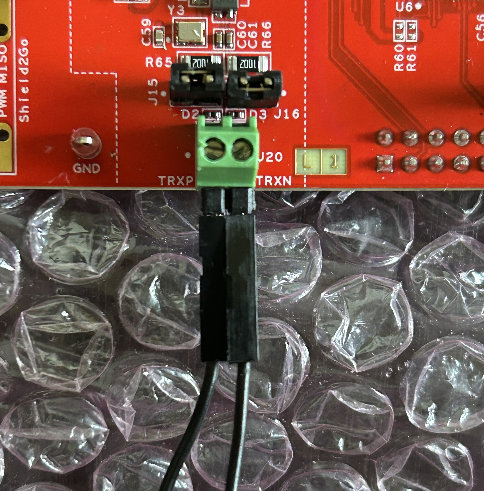
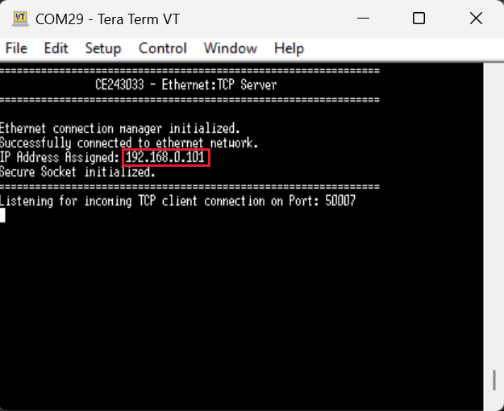
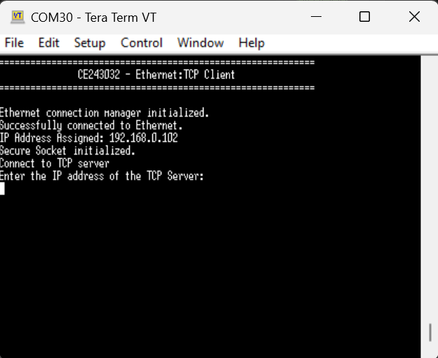
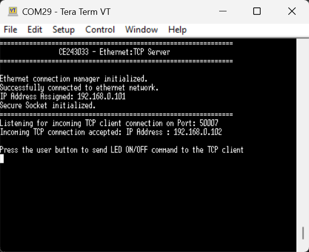
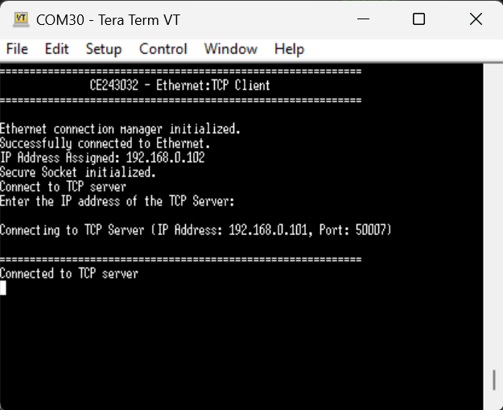
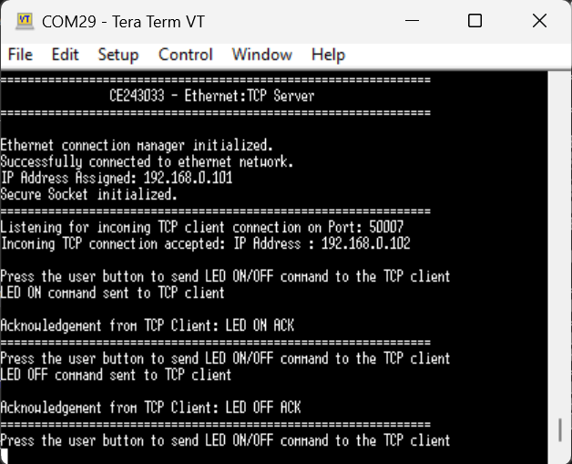
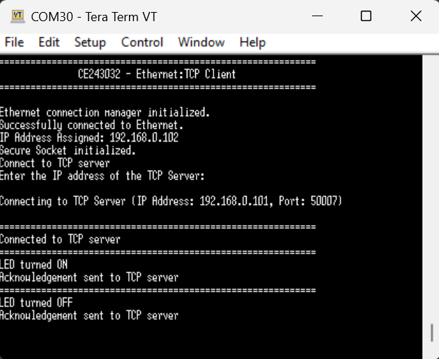
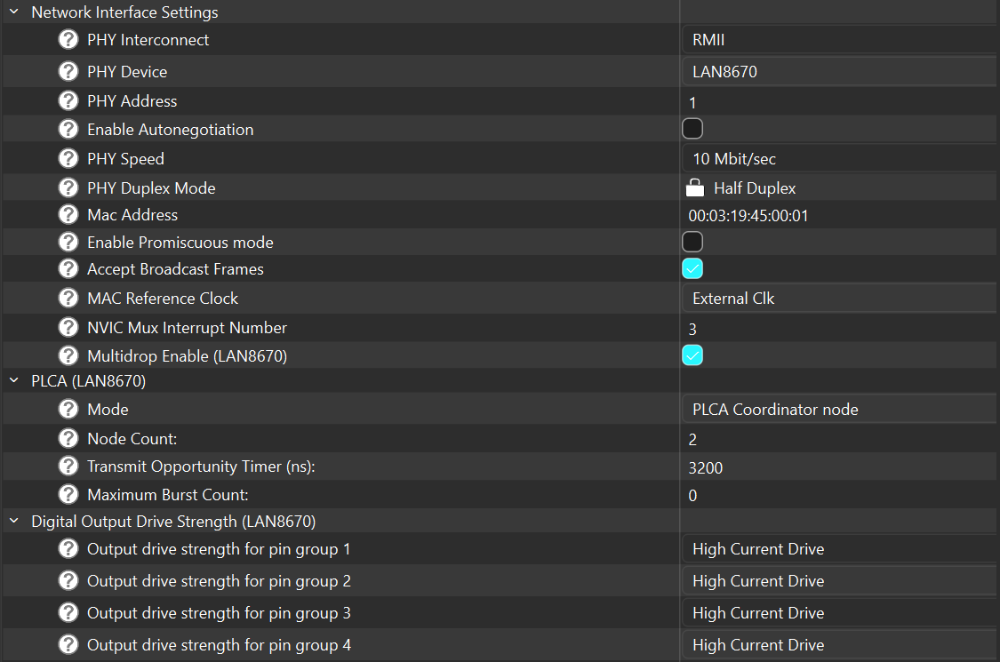
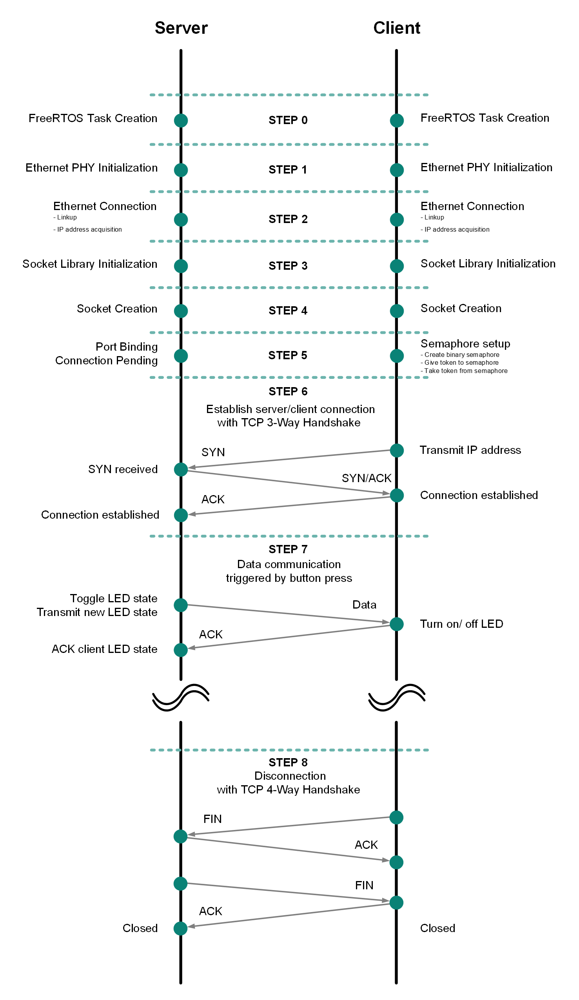

# PDL: Ethernet TCP server

This code example demonstrates the implementation of a secure TCP server with TRAVEO&trade; T2G.

In this example, the TCP server establishes a connection with a TCP client. Once the connection is established successfully, the server allows the user to send an LED ON/OFF command to the TCP client; the client responds by sending an acknowledgement message to the server.

This example uses the Ethernet Core FreeRTOS lwIP mbedtls library. This library enables Ethernet-based application development by bundling together other libraries such as FreeRTOS, lwIP TCP/IP stack, Mbed TLS, and Secure sockets. The Secure sockets library provides an easy-to-use API by abstracting the network stack (lwIP) and the security stack (Mbed TLS).

[View this README on GitHub.](https://github.com/Infineon/mtb-example-ce243033-ethernet-tcp-server)

[Provide feedback on this code example.](https://yourvoice.infineon.com/jfe/form/SV_1NTns53sK2yiljn?Q_EED=eyJVbmlxdWUgRG9jIElkIjoiQ0UyNDMwMzMiLCJTcGVjIE51bWJlciI6IjAwMi00MzAzMyIsIkRvYyBUaXRsZSI6IlBETDogRXRoZXJuZXQgVENQIHNlcnZlciIsInJpZCI6ImtvamkubWl6dW1vdG9AaW5maW5lb24uY29tIiwiRG9jIHZlcnNpb24iOiIxLjAuMCIsIkRvYyBMYW5ndWFnZSI6IkVuZ2xpc2giLCJEb2MgRGl2aXNpb24iOiJNQ0QiLCJEb2MgQlUiOiJBVVRPIiwiRG9jIEZhbWlseSI6IkFVVE8gTUNVIn0=)


## Requirements

- [ModusToolbox&trade;](https://www.infineon.com/modustoolbox) v3.8 or later (tested with v3.8)
- Board support package (BSP) minimum required version: 3.0.0
- Programming language: C


## Supported toolchains (make variable 'TOOLCHAIN')

- GNU Arm&reg; Embedded Compiler v14.2.1 (`GCC_ARM`) – Default value of `TOOLCHAIN`
- Arm&reg; Compiler v6.22 (`ARM`)
- IAR C/C++ Compiler v9.50.2 (`IAR`)


## Supported kits (make variable 'TARGET')

- [TRAVEO&trade; T2G Body high 16M Evaluation Kit](https://www.infineon.com/design-resources/finder-selection-tools/evaluation-board) (`KIT_T2G_B-H-16M_LITE`) – Default value of `TARGET`


## Hardware setup

This code example requires an Ethernet PHY connection to establish communication between the TCP server board and TCP client board. The Ethernet PHY connection is available by default in the supported kits. TRXP and TRXN should be connected to the other board's TRXP and TRXN from J20 via two jumpers as shown in **Figure 1**.

   **Figure 1.  Ethernet PHY connection**

   

Also, both boards ground (GND) should be connected together to establish a common reference for the Ethernet communication.


## Software setup

See the [ModusToolbox&trade; tools package installation guide](https://www.infineon.com/ModusToolboxInstallguide) for information about installing and configuring the tools package.

Install a terminal emulator if you don't have one. Instructions in this document use [Tera Term](https://teratermproject.github.io/index-en.html).

For the peer board acting as a TCP client, use the [Ethernet TCP client](https://github.com/Infineon/mtb-example-ce243032-ethernet-tcp-client) code example.


## Using the code example


### Create the project

The ModusToolbox&trade; tools package provides the Project Creator as both a GUI tool and a command line tool.

<details><summary><b>Use Project Creator GUI</b></summary>

1. Open the Project Creator GUI tool

   There are several ways to do this, including launching it from the dashboard or from inside the Eclipse IDE. For more details, see the [Project Creator user guide](https://www.infineon.com/ModusToolboxProjectCreator) (locally available at *{ModusToolbox&trade; install directory}/tools_{version}/project-creator/docs/project-creator.pdf*)

2. On the **Choose Board Support Package (BSP)** page, select a kit supported by this code example. See [Supported kits](#supported-kits-make-variable-target)

   > **Note:** To use this code example for a kit not listed here, you may need to update the source files. If the kit does not have the required resources, the application may not work

3. On the **Select Application** page:

   a. Select the **Applications(s) Root Path** and the **Target IDE**

      > **Note:** Depending on how you open the Project Creator tool, these fields may be pre-selected for you

   b. Select this code example from the list by enabling its check box

      > **Note:** You can narrow the list of displayed examples by typing in the filter box

   c. (Optional) Change the suggested **New Application Name** and **New BSP Name**

   d. Click **Create** to complete the application creation process

</details>


<details><summary><b>Use Project Creator CLI</b></summary>

The 'project-creator-cli' tool can be used to create applications from a CLI terminal or from within batch files or shell scripts. This tool is available in the *{ModusToolbox&trade; install directory}/tools_{version}/project-creator/* directory.

Use a CLI terminal to invoke the 'project-creator-cli' tool. On Windows, use the command-line 'modus-shell' program provided in the ModusToolbox&trade; installation instead of a standard Windows command-line application. This shell provides access to all ModusToolbox&trade; tools. You can access it by typing "modus-shell" in the search box in the Windows menu. In Linux and macOS, you can use any terminal application.

The following example clones the "[Ethernet TCP Server](https://github.com/Infineon/mtb-example-ce243033-ethernet-tcp-server)" application with the desired name "Ethernet_TCP_Server" configured for the *KIT_T2G_B-H-16M_LITE* BSP into the specified working directory, *C:/mtb_projects*:

   ```
   project-creator-cli --board-id KIT_T2G_B-H-16M_LITE --app-id mtb-example-ce243033-ethernet-tcp-server --user-app-name Ethernet_TCP_Server --target-dir "C:/mtb_projects"
   ```

The 'project-creator-cli' tool has the following arguments:

Argument | Description | Required/optional
---------|-------------|-----------
`--board-id` | Defined in the <id> field of the [BSP](https://github.com/Infineon?q=bsp-manifest&type=&language=&sort=) manifest | Required
`--app-id`   | Defined in the <id> field of the [CE](https://github.com/Infineon?q=ce-manifest&type=&language=&sort=) manifest | Required
`--target-dir`| Specify the directory in which the application is to be created if you prefer not to use the default current working directory | Optional
`--user-app-name`| Specify the name of the application if you prefer to have a name other than the example's default name | Optional

<br>

> **Note:** The project-creator-cli tool uses the `git clone` and `make getlibs` commands to fetch the repository and import the required libraries. For details, see the "Project creator tools" section of the [ModusToolbox&trade; tools package user guide](https://www.infineon.com/ModusToolboxUserGuide) (locally available at {ModusToolbox&trade; install directory}/docs_{version}/mtb_user_guide.pdf).

</details>


### Open the project

After the project has been created, you can open it in your preferred development environment.


<details><summary><b>Eclipse IDE</b></summary>

If you opened the Project Creator tool from the included Eclipse IDE, the project will open in Eclipse automatically.

For more details, see the [Eclipse IDE for ModusToolbox&trade; user guide](https://www.infineon.com/MTBEclipseIDEUserGuide) (locally available at *{ModusToolbox&trade; install directory}/docs_{version}/mt_ide_user_guide.pdf*).

</details>


<details><summary><b>Visual Studio (VS) Code</b></summary>

Launch VS Code manually, and then open the generated *{project-name}.code-workspace* file located in the project directory.

For more details, see the [Visual Studio Code for ModusToolbox&trade; user guide](https://www.infineon.com/MTBVSCodeUserGuide) (locally available at *{ModusToolbox&trade; install directory}/docs_{version}/mt_vscode_user_guide.pdf*).

</details>


<details><summary><b>Arm&reg; Keil&reg; µVision&reg;</b></summary>

Double-click the generated *{project-name}.cprj* file to launch the Keil&reg; µVision&reg; IDE.

For more details, see the [Arm&reg; Keil&reg; µVision&reg; for ModusToolbox&trade; user guide](https://www.infineon.com/MTBuVisionUserGuide) (locally available at *{ModusToolbox&trade; install directory}/docs_{version}/mt_uvision_user_guide.pdf*).

</details>


<details><summary><b>IAR Embedded Workbench</b></summary>

Open IAR Embedded Workbench manually, and create a new project. Then select the generated *{project-name}.ipcf* file located in the project directory.

For more details, see the [IAR Embedded Workbench for ModusToolbox&trade; user guide](https://www.infineon.com/MTBIARUserGuide) (locally available at *{ModusToolbox&trade; install directory}/docs_{version}/mt_iar_user_guide.pdf*).

</details>


<details><summary><b>Command line</b></summary>

If you prefer to use the CLI, open the appropriate terminal, and navigate to the project directory. On Windows, use the command-line 'modus-shell' program; on Linux and macOS, you can use any terminal application. From there, you can run various `make` commands.

For more details, see the [ModusToolbox&trade; tools package user guide](https://www.infineon.com/ModusToolboxUserGuide) (locally available at *{ModusToolbox&trade; install directory}/docs_{version}/mtb_user_guide.pdf*).

</details>


## Operation

1. Connect the board to your PC using the provided USB cable through the KitProg3 USB connector.

2. Open a terminal program and select the KitProg3 COM port. Set the serial port parameters to 8N1 and 115200 baud.

3. Program the board using one of the following:

   <details><summary><b>Using Eclipse IDE</b></summary>

      1. Select the application project in the Project Explorer.

      2. In the **Quick Panel**, scroll down, and click **\<Application Name> Program (KitProg3_MiniProg4)**.
   </details>


   <details><summary><b>In other IDEs</b></summary>

   Follow the instructions in your preferred IDE.
   </details>


   <details><summary><b>Using CLI</b></summary>

     From the terminal, execute the `make program` command to build and program the application using the default toolchain to the default target. The default toolchain is specified in the application's Makefile but you can override this value manually:
      ```
      make program TOOLCHAIN=<toolchain>
      ```

      Example:
      ```
      make program TOOLCHAIN=GCC_ARM
      ```
   </details>

4. Make a note of the IP address assigned to the kit (server) as shown in **Figure 2**. It is **192.168.0.101** as a default.

   **Figure 2. TCP server before establishing Ethernet connection**

   

5. Enter the TCP server IP address in the TCP client terminal to establish a connection between the TCP client and TCP server.

   **Figure 3. TCP client before establishing Ethernet connection**

   

6. Confirm the successful connection establishment in both TCP server and TCP client terminals.

   **Figure 4. TCP server after establishing Ethernet connection**

   

   <br>

   **Figure 5. TCP client after establishing Ethernet connection**

   

7. Press the user button (SW2) to send the LED ON/OFF command to the TCP client. Each user button press will issue the LED ON or LED OFF commands alternately. The client in turn sends an acknowledgment message back to the server. **Figure 6** and **Figure 7** show the TCP server and TCP client outputs respectively.

   **Figure 6. TCP server output**

   

   <br>

   **Figure 7. TCP client output**

   


## Debugging

You can debug the example to step through the code.


<details><summary><b>In Eclipse IDE</b></summary>

Use the **\<Application Name> Debug (KitProg3_MiniProg4)** configuration in the **Quick Panel**. For details, see the "Program and debug" section in the [Eclipse IDE for ModusToolbox&trade; user guide](https://www.infineon.com/MTBEclipseIDEUserGuide).


</details>


<details><summary><b>In other IDEs</b></summary>

Follow the instructions in your preferred IDE.

</details>


## Design and implementation

This example executes an RTOS task: TCP server task.

The TRAVEO&trade; T2G MCU is configured as a TCP server that establishes a connection with a TCP client.
Once the connection is established successfully, the server allows the user to send an LED ON/OFF command to the TCP client; the client responds by sending an acknowledgement message to the server.

### Ethernet PHY configuration

For `KIT_T2G_B-H-16M_LITE`, [LAN8670](https://www.microchip.com/en-us/product/LAN8670) Ethernet PHY is used. The PHY is configured in 10BASE-T1S mode, which is a single-pair Ethernet physical layer standard that supports 10 Mbps data rate over a single twisted pair cable. The PHY is connected to the TRAVEO&trade; T2G MCU via the Reduced Media Independent Interface (RMII) and is powered by a 3.3 V supply from the board.

For reference, the MAC address is set to 00:03:19:45:00:01 for the server and 00:03:19:45:00:02 for the client to avoid MAC address conflicts. (The MAC address prefix "00:03:19" is registered to Infineon AG.)

LAN8670 supports the Physical Layer Collision Avoidance (PLCA) feature, which allows multiple nodes to share the same physical medium without collisions in a multidrop topology. In this example, the PLCA mode is set to coordinator for the server and follower for the client. The PLCA node count is set to 2, representing the server and the client. The transmit opportunity timer is set to 3200 ns, which is appropriate for segments specified in the 10BASE-T1S standard (IEEE 802.3 Clause 147) and must be set to the same value on all nodes in the PLCA domain to maintain synchronization.

**Figure 8. LAN8670 Ethernet PHY configuration**



### IP settings

For this example, Dynamic Host Configuration Protocol (DHCP) is not used. The server is assigned a static IP address of **192.168.0.101** with a subnet mask of **255.255.255.0** and a gateway address of **192.168.0.100**. The client is assigned a static IP address of **192.168.0.102** with the same subnet mask and gateway address.

**Table 1. IP settings**

 Device  |  IP address     |  Subnet mask  |  Gateway
 :-------- | :-------------    | :------------ | :------------
 Server | 192.168.0.101 | 255.255.255.0 | 192.168.0.100
 Client | 192.168.0.102 | 255.255.255.0 | 192.168.0.100

<br>

### TCP communication sequence

The following figure illustrates the sequence of operations and data interactions between the TCP server and the TCP client during the communication process.

For a quick overview, Table 2 summarizes what each step does.

**Table 2. TCP communication step summary**

| Step | What happens |
|------|--------------|
| 0 | Create FreeRTOS tasks for server/client processing |
| 1 | Initialize Ethernet stack, interface, and PHY settings |
| 2 | Bring Ethernet link up and get IP configuration |
| 3 | Initialize Secure Sockets runtime |
| 4 | Create TCP sockets and register callback handlers |
| 5 | Server starts listening on a fixed port; client waits and prepares to connect |
| 6 | Client connects and server accepts the TCP connection |
| 7 | Server sends LED control command; client executes and returns ACK |
| 8 | On disconnect, sockets are closed/deleted and client prepares to reconnect |

**Figure 9. TCP Client/Server communication sequence**



The following table shows each step of the TCP Client/Server communication protocol over 10BASE-T1S Ethernet, the corresponding API functions, and their roles.

**Table 3. TCP communication steps and corresponding functions**

| Step | Side | Function | Description |
|------|------|----------|-------------|
| 0 | Both | `xTaskCreate()` | Creates the FreeRTOS task for TCP server/client operation |
| 1 | Both | `cy_ecm_init()` | Initializes the Ethernet Connection Manager |
| 1 | Both | `cy_ecm_ethif_init()` | Initializes the Ethernet interface and 10BASE-T1S PHY driver |
| 2 | Both | `cy_ecm_connect()` | Establishes the Ethernet link and obtains an IP address (DHCP or static) |
| 3 | Both | `cy_socket_init()` | Initializes the Secure Sockets library (lwIP + Mbed TLS) |
| 4 | Both | `cy_socket_create()` | Creates a TCP socket (CY_SOCKET_IPPROTO_TCP) |
| 4 | Both | `cy_socket_setsockopt()` | Registers callback functions for receive, connect, and disconnect events |
| 5 | Server | `cy_socket_bind()` | Binds the server socket to the local IP address and port 50007 |
| 5 | Server | `cy_socket_listen()` | Starts listening for incoming TCP client connections |
| 5 | Client | `xSemaphoreTake()` | Waits on binary semaphore before attempting connection to the server |
| 6 | Client | `cy_socket_connect()` | Initiates TCP 3-way handshake (SYN → SYN+ACK → ACK) to the server |
| 6 | Server | `cy_socket_accept()` | Accepts the incoming client connection (called in tcp_connection_handler callback) |
| 7 | Server | `xTaskNotifyWait()` | Waits for a button-press notification from the ISR |
| 7 | Server | `cy_socket_send()` | Sends LED ON/OFF command ('1'/'0') to the connected TCP client |
| 7 | Client | `cy_socket_recv()` | Receives the LED command from the server (called in tcp_client_recv_handler callback) |
| 7 | Client | `cy_socket_send()` | Sends acknowledgement message ("LED ON ACK" / "LED OFF ACK") back to the server |
| 7 | Server | `cy_socket_recv()` | Receives the acknowledgement from the client (called in tcp_receive_msg_handler callback) |
| 8 | Both | `cy_socket_disconnect()` | Gracefully disconnects the TCP connection |
| 8 | Both | `cy_socket_delete()` | Frees resources allocated to the socket |
| 8 | Client | `xSemaphoreGive()` | Releases the semaphore to trigger reconnection to the server |


<br>

### Resources and settings

**Table 4. Application resources**

 Resource  |  Alias/object     |    Purpose
 :-------- | :-------------    | :------------
 Ethernet  | eth_0             | Ethernet interface instance used for TCP server
 UART      | UART              | UART interface instance used for terminal output
 BUTTON (BSP) | CYBSP_USER_BTN | User button to send LED ON/OFF commands to the TCP client

<br>


## Related resources

Resources  | Links
-----------|----------------------------------
Application notes  |  [AN235305](https://www.infineon.com/assets/row/public/documents/10/42/infineon-an235305-getting-started-with-traveo-t2g-family-mcus-in-modustoolbox-applicationnotes-en.pdf) – Getting started with TRAVEO™ T2G family MCUs in ModusToolbox&trade; <br> [AN220193](https://documentation.infineon.com/traveo/docs/qno1699881339239) – GPIO usage setup in TRAVEO&trade; T2G family
Code examples  | [Using ModusToolbox&trade;](https://github.com/Infineon/Code-Examples-for-ModusToolbox-Software) on GitHub
Device documentation | [TRAVEO&trade; T2G body high 16M family MCUs datasheets](https://www.infineon.com/products/microcontroller/32-bit-traveo-t2g-arm-cortex/for-body/t2g-cyt6bj/#documents) <br> [TRAVEO&trade; T2G body high family MCUs architecture/registers reference manuals](https://www.infineon.com/products/microcontroller/32-bit-traveo-t2g-arm-cortex/for-body#documents)
Development kits | Select your kits from the [Evaluation board finder](https://www.infineon.com/cms/en/design-support/finder-selection-tools/product-finder/evaluation-board)
Libraries on GitHub  | [mtb-pdl-cat1](https://github.com/Infineon/mtb-pdl-cat1) – Peripheral Driver Library (PDL) <br> [retarget-io](https://github.com/Infineon/retarget-io) – Utility library to retarget STDIO messages to a UART port　<br> [ethernet-connection-manager](https://github.com/Infineon/ethernet-connection-manager) – Library to manage ethernet connectivity　<br> [ethernet-core-freertos-lwip-mbedtls](https://github.com/Infineon/ethernet-core-freertos-lwip-mbedtls) – Library bundles FreeRTOS, lwIP TCP/IP stack, mbed TLS for security, ethernet connection manager (ECM), secure sockets interface, connectivity utilities and configuration files　<br> [ethernet-phy-driver](https://github.com/Infineon/ethernet-phy-driver) – Library for ethernet PHY-related interface APIs　<br> [secure-sockets](https://github.com/Infineon/secure-sockets) – Library provides APIs to create software that can send and/or receive data over the network using sockets
Tools  | [ModusToolbox&trade;](https://www.infineon.com/modustoolbox) – ModusToolbox&trade; software is a collection of easy-to-use libraries and tools enabling rapid development with Infineon MCUs for applications ranging from wireless and cloud-connected systems, edge AI/ML, embedded sense and control, to wired USB connectivity using PSOC&trade; Industrial/IoT MCUs, AIROC&trade; Wi-Fi and Bluetooth&reg; connectivity devices, XMC&trade; Industrial MCUs, and EZ-USB&trade;/EZ-PD&trade; wired connectivity controllers. ModusToolbox&trade; incorporates a comprehensive set of BSPs, HAL, libraries, configuration tools, and provides support for industry-standard IDEs to fast-track your embedded application development

<br>


## Other resources

Infineon provides a wealth of data at [www.infineon.com](https://www.infineon.com) to help you select the right device, and quickly and effectively integrate it into your design.


## Document history

Document title: *CE243033* – *PDL: Ethernet TCP server*

 Version | Description of change
 ------- | ---------------------
 1.0.0   | New code example

<br>

All referenced product or service names and trademarks are the property of their respective owners.

The Bluetooth® word mark and logos are registered trademarks owned by Bluetooth SIG, Inc., and any use of such marks by Infineon is under license.

PSOC™, formerly known as PSoC™, is a trademark of Infineon Technologies. Any references to PSoC™ in this document or others shall be deemed to refer to PSOC™.

---------------------------------------------------------

(c) 2026, Infineon Technologies AG, or an affiliate of Infineon Technologies AG. All rights reserved.
This software, associated documentation and materials ("Software") is owned by Infineon Technologies AG or one of its affiliates ("Infineon") and is protected by and subject to worldwide patent protection, worldwide copyright laws, and international treaty provisions. Therefore, you may use this Software only as provided in the license agreement accompanying the software package from which you obtained this Software. If no license agreement applies, then any use, reproduction, modification, translation, or compilation of this Software is prohibited without the express written permission of Infineon.
<br>
Disclaimer: UNLESS OTHERWISE EXPRESSLY AGREED WITH INFINEON, THIS SOFTWARE IS PROVIDED AS-IS, WITH NO WARRANTY OF ANY KIND, EXPRESS OR IMPLIED, INCLUDING, BUT NOT LIMITED TO, ALL WARRANTIES OF NON-INFRINGEMENT OF THIRD-PARTY RIGHTS AND IMPLIED WARRANTIES SUCH AS WARRANTIES OF FITNESS FOR A SPECIFIC USE/PURPOSE OR MERCHANTABILITY. Infineon reserves the right to make changes to the Software without notice. You are responsible for properly designing, programming, and testing the functionality and safety of your intended application of the Software, as well as complying with any legal requirements related to its use. Infineon does not guarantee that the Software will be free from intrusion, data theft or loss, or other breaches (“Security Breaches”), and Infineon shall have no liability arising out of any Security Breaches. Unless otherwise explicitly approved by Infineon, the Software may not be used in any application where a failure of the Product or any consequences of the use thereof can reasonably be expected to result in personal injury.
